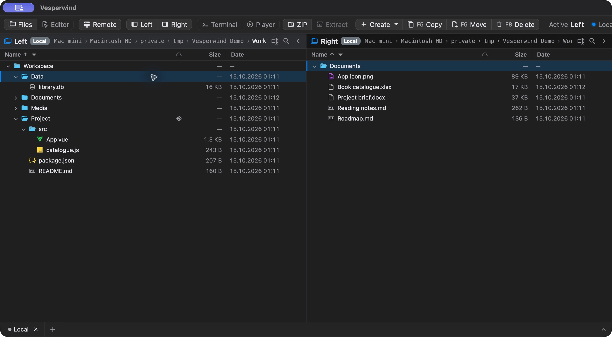
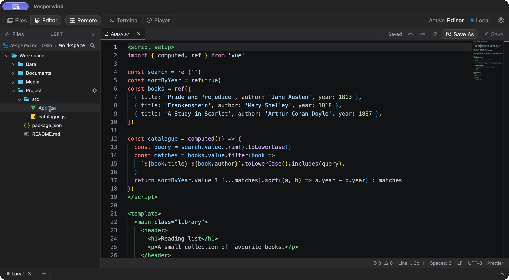
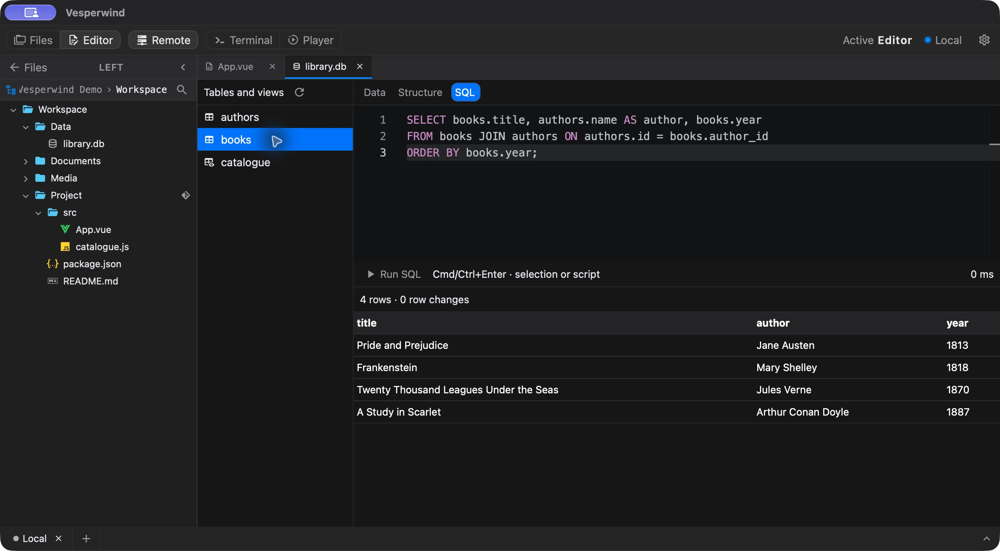
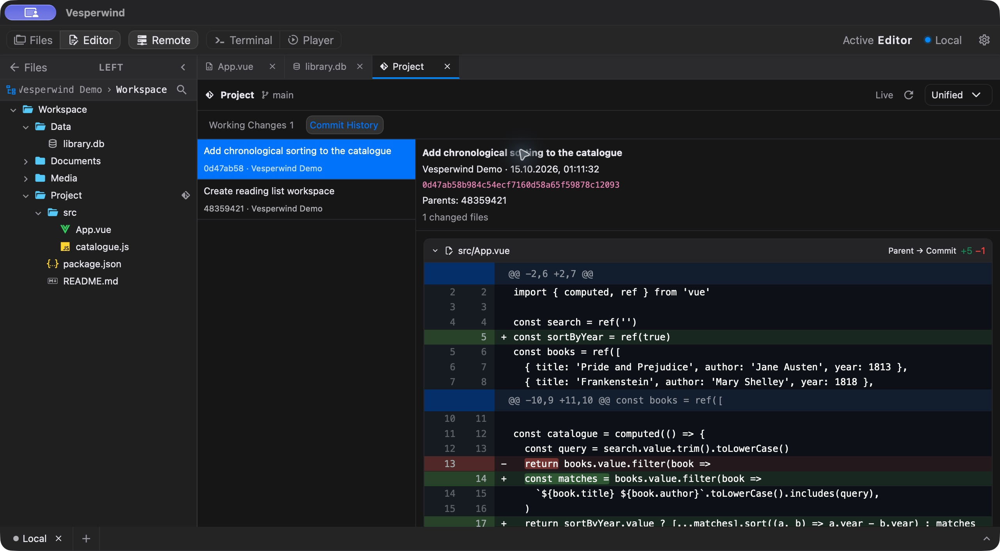

  

<h1 align="center">Vesperwind</h1>

  <strong>A dual-pane file manager with editors, viewers and terminals built in.</strong> 
  Local files and remote servers, together in one desktop workspace.

  <a href="#get-started">Get started</a> ·
  <a href="#documentation">Documentation</a> ·
  <a href="CONTRIBUTING.md">Contribute</a>

macOS desktop app · Demonstration files

## 📂 Files, local and remote

Browse two independent panels. Copy, move, rename and organise files with keyboard
shortcuts, context menus and drag-and-drop. Connect over **SSH/SFTP, FTP or FTPS**
and transfer files between providers without leaving the workspace.

Follow breadcrumbs, type a path with **Cmd/Ctrl+L**, search recursively, or filter
and sort each panel. Create ZIP archives and extract ZIP, TAR, TGZ, RAR and RAR5.
On macOS, iCloud badges show which files need downloading; browsing a folder
never downloads its contents.

The desktop clipboard and drag-and-drop work with Finder and Explorer, including
SFTP transfers. Mount or eject disk images, reveal an item in the system file
manager, or open it with another application.

## 📝 Code and documents

Open local or remote source files in **Monaco** with syntax highlighting, a minimap,
search, indentation controls, and your preferred editor font and size.
Keep several files open and the project tree within reach.

Edit **DOCX, XLSX and XLS**, import DOC and RTF through bundled LOWA in desktop
builds, or write Markdown in WYSIWYG and source modes. PDFs and PPTX presentations
have read-only previews with page navigation, thumbnails, search and text selection.

## 🗃️ SQLite beside your files

Double-click a **`.db`, `.sqlite` or `.sqlite3`** file. Vesperwind checks that it is
a SQLite database, then opens its tables, views and structure in a dedicated tab.

Write SQL in Monaco, inspect results, and run **INSERT, UPDATE, DELETE and schema
changes** against local databases and mounted volumes. Explicit transactions,
Commit/Rollback controls and query cancellation are available.

See the [SQLite guide](docs/sqlite-editor.md) for execution limits and transaction
behaviour. SQL editing in browser/SEA mode requires Node.js 24.10 or newer.

## 🌿 Git changes as they happen

Inspect **working changes, staged changes and commit history** in a read-only Git
tab. Browse the files touched by each commit, collapse individual diffs, and choose
unified or split views. Large diffs load on demand.

The view updates as external tools edit files, create commits or switch branches.

## 🎧 Preview, play and keep working

Press **Space** for Quick Look: a temporary read-only preview of media, code,
Markdown, PDF, Office documents and spreadsheets. Press Space again to close it;
in the video player, Space pauses or resumes playback instead.

Play local or remote audio/video, HTTP/HTTPS streams and HLS. The audio player
keeps its queue between launches, with drag reordering, repeat, shuffle and M3U
import/export. M4B audiobooks retain playback position; Tauri uses bundled libmpv,
including FLAC, AC-3 and E-AC-3 playback.

Open multiple **local PTY and SSH terminal tabs** alongside your files and editors.

## Get started

| Runtime | Platforms | Setup |
| --- | --- | --- |
| Desktop | macOS · Apple Silicon | [Development and builds](docs/development.md) · [App & DMG packaging](docs/development.md#macos-app-and-dmg-packaging) |
| Desktop | Windows · x64 | [Windows build guide](docs/build-windows.md) · [Single-file portable EXE](docs/build-windows.md#single-file-portable-application) |
| Browser / SEA | Node.js backend | [Run locally or build a standalone executable](docs/development.md) |

Linux desktop packaging is not yet supported.

## Documentation

| Explore | Guides |
| --- | --- |
| Files & connections | [Archives, paths & mounted shares](docs/archives-and-navigation.md) · [FTP & FTPS](docs/ftp-ftps.md) · [File operation lifecycle](docs/file-operation-lifecycle.md) |
| Editors | [Word](docs/word-documents.md) · [Spreadsheets](docs/spreadsheets.md) · [Markdown](docs/markdown-documents.md) · [Office conversion](docs/office-conversion.md) |
| Databases & Git | [SQLite](docs/sqlite-editor.md) · [Git diffs & live monitoring](docs/git-live-monitoring.md) |
| Previews & playback | [Quick Look](docs/quick-look.md) · [Media & playlists](docs/media-player.md) · [Seeking & thumbnails](docs/video-thumbnails.md) · [Playback history](docs/media-history.md) |
| Media details | [Content availability](docs/media-content.md) · [Native playback, HDR & Dolby Vision](docs/libmpv.md#hdr-and-color-pipeline) |

## Contributing

Bug reports, focused fixes and improvements are welcome.
[CONTRIBUTING.md](CONTRIBUTING.md) covers setup and project conventions.

## License

[MIT](LICENSE), © 2026 Ivan Ovsyannikov. Third-party components retain their own
licenses; see [Third-party notices](THIRD_PARTY_NOTICES.md).
